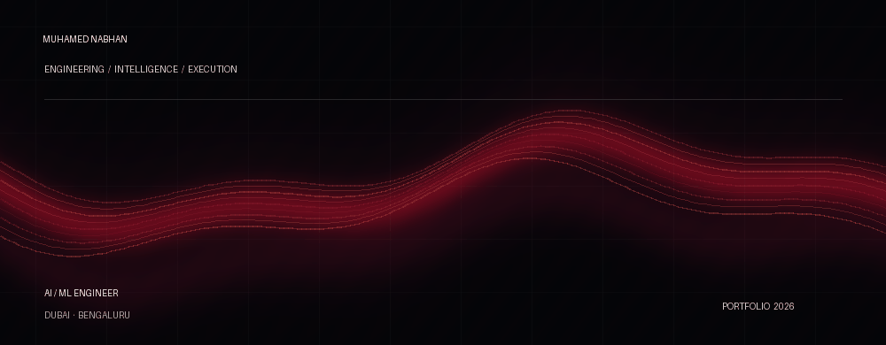

 

&nbsp;

&nbsp;

  

BUILD WITH INTENT. SHIP WITH PURPOSE.

---

<table>
<tr>
<td width="58%" valign="top">

### THE SHORT VERSION

I'm **Muhamed Nabhan** — an AI/ML engineer who likes getting into the details, building things that work, and seeing an idea through to the finish line.

My work spans applied machine learning, computer vision, LLM-powered systems, and automation. I've built across research and product environments, from explainable satellite-image analysis to multilingual voice workflows and business automation.

I prefer practical engineering: understand the problem, build the system, test the edges, make it better.

</td>
<td width="42%" valign="top">

### CURRENT TOOLKIT

`Python` `TensorFlow` `Keras`  
`Scikit-learn` `OpenCV` `YOLOv8`  
`Vision Transformers` `SHAP` `Grad-CAM`  
`LLMs` `RAG` `NLTK`  
`FastAPI` `Flask` `Gradio`  
`Docker` `AWS` `n8n`  
`Copilot Studio` `Git` `GitHub`

</td>
</tr>
</table>

## SELECTED WORK

| 01 — RESEARCH / COMPUTER VISION | 02 — VOICE AI / AUTOMATION |
|:--|:--|
| **Explainable Multispectral Crop Stress Detection** | **Multilingual Patient Assistance System** |
| Vision Transformers + Sentinel-2 imagery to identify crop stress before visible symptoms. SHAP and Grad-CAM make model decisions interpretable. | Multilingual patient intake and appointment workflows in English, Arabic, Hindi, and Malayalam, with voice transcription, TTS, patient retrieval, and emergency escalation. |

| 03 — KNOWLEDGE SYSTEMS | 04 — HUMAN-COMPUTER INTERACTION |
|:--|:--|
| **Cultural Heritage RAG** | **Real-Time Hand Gesture Recognition** |
| Multi-source retrieval across cultural heritage APIs, with source attribution and grounded answers. | MediaPipe + OpenCV gesture controls for cursor movement, volume, and click operations. |

| 05 — BUSINESS AUTOMATION | 06 — NLP / CHATBOTS |
|:--|:--|
| **AI Agents & Invoice Automation** | **Dexter — Mental Health Support Chatbot** |
| Agent-based workflows for data retrieval, automated messaging, and invoice generation. | Fine-tuned neural-chat-7b-v3 with a custom dataset, developed through the Intel Unnati programme. |

## EXPERIENCE

**AI Engineering Intern** · Innobayt Innovative Solutions  
Dubai, UAE · Dec 2025 — Feb 2026

Built AI agents and small-scale models for business automation, including automated messaging and invoice generation workflows.

**Product Documentation Intern** · OHC  
Remote · Feb 2025 — Aug 2025

Created technical documentation and tutorials, tested UI workflows, and validated module outputs through local deployment.

**Intel® Unnati AI Trainee**  
Remote · May 2024 — Jul 2024

Developed and fine-tuned an AI-powered mental health chatbot using Intel neural-chat-7b-v3 and a custom dataset.

## RESEARCH & RECOGNITION

- **Research publication (2025):** Co-authored *Effective Explainable Model to Detect Multispectral Crop Stress Using ViT*.
- **KSCST 49th Student Project Programme (2025–26):** Government-funded research project, Government of Karnataka.
- **State-level presentation:** Poster presentation and exhibition at SPP 2025–26.

## EDUCATION

**B.Tech — Artificial Intelligence & Machine Learning**  
Christ University, Bengaluru · Aug 2022 — May 2026

---

### HAVE SOMETHING WORTH BUILDING?

 

  

  

MUHAMED NABHAN · ENGINEERING, WITH INTENT.

