 

---

### A little about me

AI/ML engineer interested in building practical intelligent systems across **computer vision, LLMs, RAG and automation**. I enjoy taking ideas from prototype to working product.

**Based in Dubai, UAE** · Christ University · B.Tech, Artificial Intelligence & Machine Learning

### Selected work

| Project | Focus |
|---|---|
| Explainable Multispectral Crop Stress Detection | Explainable AI · Vision Transformers |
| Multilingual LLM-Based System for Automated Patient Assistance | LLMs · Voice AI |
| RAG-Based Cultural Heritage Knowledge Retrieval | RAG · Information Retrieval |
| Gesture Arcade | Interactive UI · Game Development |
| Dexter — Mental Health Chatbot | NLP · Conversational AI |
| PPE Detection System | Computer Vision · YOLO |
| Brain Tumor Detection | Medical Imaging · Deep Learning |
| Movie Recommendation System | Machine Learning · NLP |
| Li-Fi Technology | Communication Systems |
| Social Distancing ID Card | Computer Vision |
| Visual Impairment Assistance | Object Detection |
| Food Presentation Quality Assessment | Computer Vision · OpenCV |

### Experience

- **AI Engineering Intern** — Innobayt Innovative Solutions · Dec 2025 – Feb 2026
- **Product Documentation Intern** — OHC · Feb 2025 – Aug 2025
- **Intel® Unnati AI Trainee** — May 2024 – Jul 2024

### Toolkit

`Python` `TensorFlow` `Keras` `Scikit-learn` `OpenCV` `YOLOv8` `Vision Transformers`  
`RAG` `LLMs` `NLTK` `SHAP` `Grad-CAM` `FastAPI` `Flask` `Gradio`  
`n8n` `Docker` `Git` `AWS` `Google Colab`

### Beyond the code

- Co-author of a 2025 research publication on explainable multispectral crop stress detection.
- Government-funded KSCST research project under the 49th Student Project Programme.
- Selected for the State-Level Poster Presentation & Exhibition, SPP 2025–26.

---

  

